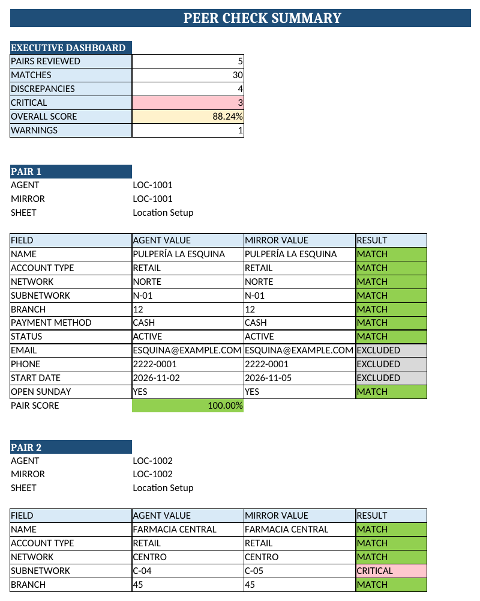

# Peer Check ✅

Herramienta en Python que **revisa automáticamente el trabajo de configuración (setup) capturado por un analista**, comparándolo campo por campo con la captura de control que hace un colega (*mirror*). El resultado es un Excel con las diferencias marcadas en colores y un resumen con puntajes.

Reemplaza la revisión manual de "cuatro ojos": lo que antes era comparar columnas a mano ahora toma segundos, y además deja evidencia de cada revisión.



*Ejemplo con datos ficticios (`ejemplo/generar_ejemplo.py`).*

📘 **[Guía de uso paso a paso](docs/GUIA_DE_USO.md)**: instalación, cómo preparar el Excel, correr la revisión y leer el resultado.

## Qué hace

- **Empareja los registros**: el Agent 1 con el Mirror 1, el Agent 2 con el Mirror 2, y así sucesivamente, en todas las hojas del libro.
- **Compara cada campo** después de limpiarlo: quita espacios invisibles, mayúsculas/minúsculas y formato (`$`, `%`, `,`), y unifica sí/no y números (`7`, `7.0` y `"7"` son iguales). Así solo cuentan las diferencias reales.
- **Clasifica cada campo**:

| Resultado | Color | Significado |
|---|---|---|
| `MATCH` | 🟩 verde | Coinciden |
| `DISCREPANCY` | 🟥 rojo | No coinciden |
| `CRITICAL` | 🟥 rojo | No coinciden en un campo crítico (por ejemplo, la cuenta bancaria) |
| `EXCLUDED` | ⬜ gris | No se compara (IDs, fechas, contacto…) |
| `EMPTY` | ⬜ gris | Vacío en ambos |

- **Puntaje por par y puntaje general** (coincidencias ÷ campos comparados), con semáforo: verde ≥ 95 %, amarillo ≥ 80 % y rojo por debajo. Los umbrales se pueden configurar.
- **Advertencias**: hojas sin `MIRROR`, cantidad distinta de agents y mirrors, o pares con IDs diferentes (señal de filas en otro orden).
- **Colorea las hojas originales** para ver las diferencias en su contexto.
- Soporta **`.xlsx` y `.xlsm`** y conserva las macros del `.xlsm`.
- **Respaldo automático** de cada archivo antes de procesarlo.

## Formato de entrada

Cada hoja debe tener los encabezados en la fila 1 y el ID en la columna A. La palabra `MIRROR`, sola en la columna A, separa la captura original de la de control:

| ID | NAME | NETWORK | BANK ACCOUNT | … |
|---|---|---|---|---|
| LOC-1001 | Pulpería La Esquina | NORTE | 100200300400 | |
| LOC-1002 | Farmacia Central | CENTRO | … | |
| **MIRROR** | | | | |
| LOC-1001 | Pulpería La Esquina | NORTE | 100200300400 | |
| LOC-1002 | Farmacia Central | CENTRO | … | |

## Uso

### 1. Instalar (una sola vez)

```bash
pip install -r requirements.txt
```

### 2. Preparar la carpeta

```
MiCarpeta/
├── config.json     ← copia de config.example.json con tus campos
├── INPUT/          ← pon aquí los Excel a revisar
├── OUTPUT/         ← aquí aparecen los *_REVIEWED.xlsx
└── BACKUP/         ← copia de seguridad de cada original, con fecha y hora
```

### 3. Ejecutar

```bash
python -m peercheck --carpeta "C:\MiCarpeta"
```

En Windows también puedes copiar `peercheck.bat` a tu carpeta y darle doble clic.

### Probarlo con el ejemplo

```bash
python ejemplo/generar_ejemplo.py
python -m peercheck --carpeta ejemplo --config config.example.json
```

## Configuración

Las reglas de cada equipo van en `config.json`, que **no se sube a GitHub** (está en `.gitignore`). Ver [`config.example.json`](config.example.json):

| Clave | Para qué sirve |
|---|---|
| `marcador_mirror` | Texto que separa la captura original de la de control (`MIRROR`). |
| `campos_criticos` | Si estos campos tienen diferencias, se marcan como `CRITICAL`. |
| `campos_excluidos` | Estos campos no se comparan. |
| `campos_sensibles` | Se comparan completos, pero en el resumen solo se ven los últimos 4 caracteres (`•••••6789`). |
| `hojas_ignoradas` | Hojas que no se revisan (instrucciones, catálogos…). |
| `ignorar_ceros_izquierda` | `true`: `0012` = `12` (Excel suele borrar los ceros). `false`: los códigos se respetan exactos. |
| `umbral_verde` / `umbral_amarillo` | Límites del semáforo del puntaje. |

Si el archivo tiene un error (por ejemplo, una coma de más), la herramienta lo dice con claridad en lugar de fallar a mitad del proceso.

## Seguridad y privacidad

- **Protección contra fórmulas maliciosas**: si una celda trae algo como `=HYPERLINK(...)`, el resumen lo guarda como texto, para que Excel no lo ejecute como fórmula.
- **Enmascarado de datos sensibles**: las cuentas bancarias y otros campos sensibles no aparecen completos en el resumen.
- **Protección contra archivos XML maliciosos** con `defusedxml`, que openpyxl usa automáticamente.
- **No se ejecutan macros**: los `.xlsm` conservan sus macros, pero la herramienta nunca las corre.
- **Nada queda escrito en el código**: no hay rutas, nombres de campos de una empresa ni datos personales en el código. Todo está en `config.json`, que es local.
- **No pierde información**: los respaldos y los resultados llevan fecha y hora, así que nunca se sobrescriben.
- **Ignora los archivos temporales de Excel** (`~$archivo.xlsx`) y los archivos de más de 50 MB, y avisa si un archivo está dañado o abierto en Excel.
- Los mensajes de la consola muestran solo nombres de archivo y conteos, **nunca valores de las celdas**.

## Cambios frente a la versión 5 (script original)

- Se separó en módulos con una responsabilidad cada uno (`normalizar`, `motor`, `reporte`, `procesar`).
- Las rutas y las listas de campos que estaban fijas en el código ahora se configuran en `config.json` o desde la línea de comandos.
- Nuevas advertencias cuando no cuadran los agents y los mirrors, o cuando los IDs de un par son distintos. Antes se ignoraban en silencio.
- Los textos como `INF` o `NAN` ya no se convierten en números por accidente.
- Las celdas combinadas ya no causan errores al colorear.
- El tablero ejecutivo está al inicio del resumen, y los puntajes son números con formato de porcentaje, así que se pueden usar en fórmulas.
- Se agregaron **32 pruebas automáticas** (`pytest`) que corren en Windows y Linux con GitHub Actions. Con un mismo archivo de prueba, los resultados son idénticos a los de la versión original.

## Pruebas

```bash
pip install -r requirements-dev.txt
pytest
```

## Estructura

```
peercheck/
├── config.py      # Carga y valida config.json
├── normalizar.py  # Limpieza de valores y enmascarado
├── motor.py       # Emparejar Agent ↔ Mirror y comparar campos
├── reporte.py     # Hoja "Peer Check Summary" y colores
├── procesar.py    # Recorre INPUT, respalda y guarda en OUTPUT
└── __main__.py    # Línea de comandos
ejemplo/           # Generador de un Excel de ejemplo con datos ficticios
tests/             # pytest
```

## Licencia

[MIT](LICENSE)
